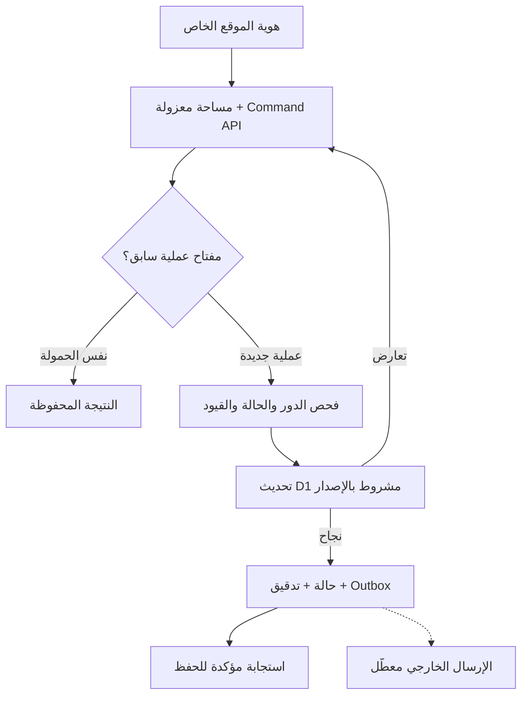

# SPORTIX PARTNERS — المعمارية والتنفيذ

الإصدار 0.2 · 9 نوفمبر 2026 · بيانات اصطناعية فقط.

## القرار والنطاق

مساحة واحدة للشريك: ROOMS CONNECT، Coupons & Subscriptions، Products، SPORTIX IMPACT. يحتفظ الشريك بمؤسسة واحدة مع وحدات وأدوار ونطاقات مستقلة. الظهور للرياضي يكون عبر SPORTIX ATHLETE / GO SPORTIX / ROOMS أو SPORTIX ATHLETE / SPORTIX MARKET بحسب نوع العرض.

اعتماد المؤسس يجيز تنفيذ هذا المختبر ونشره الخاص. لا يعني تشغيل حجوزات أو دفع حقيقي أو مشاركة بيانات حقيقية بين المؤسسات.

## المنفذ

- واجهة RTL موحدة مع رحلة الشريك، الموارد، الغرف، السوق، الهندسة، الاختبارات والأدلة.
- محرك حجز محلي قابل للتكرار: الطلب والقفل والإشعار والاستلام والتأكيد/الرفض والإلغاء والانتهاء، مع فحص السعة والأهلية والصيانة والسلامة والتفويض.
- API فعلي `GET/POST /api/sandbox` مع مصادقة هوية الموقع، وعزل مساحة كل هوية، وفحص Origin وحجم الطلب، وحفظ D1.
- تحديث ذري لوثيقة المختبر بالإصدار: بيانات المجال + Audit + Outbox + نتيجة Idempotency في التحديث نفسه. لا تنفذ أي خدمة خارجية داخل المعاملة.
- مراجعة ونشر عروض السوق، القسائم ذات الاستخدام الواحد، اشتراكات أربع حصص، حجز مخزون وطلب وشحن وإرجاع، وتسجيل IMPACT مع منع التكرار وتجاوز السعة.
- أدوار السوق والغرف محاكاة سياسات داخل مساحة خاصة. المصادقة الفعلية تخص الوصول إلى مساحة المختبر؛ لا يدّعي النموذج توفير IAM متعدد المؤسسات للإنتاج.
- الكوبونات الصادرة تستند إلى افتراض شراء اصطناعي ناجح. تفويض الدفع والتحصيل والشحن وأهلية الشريك fixtures وليست تكاملات مالية أو تحققًا قانونيًا.
- الساعة الاصطناعية ثابتة حتى تحريكها صراحة. مؤقتات الإنتاج وعامل انتهاء المهلة لم تُشغّل.

## مسار المعاملة المنفذ

كل طلب يعيد قراءة أحدث حالة بعد تعارض الكتابة، بحد أقصى 12 محاولة؛ عند استمرار الازدحام يعيد 409 ويحتفظ العميل بالمفتاح للمحاولة نفسها. الحد 1000 عملية أو وثيقة 1MB لكل مساحة مختبر. هذا تصميم محدود للاختبار وليس بنية التشغيل عالية الحجم. دفتر التدقيق append-only عبر الأوامر، وليس مخزن WORM ضد مسؤول قاعدة البيانات.

## تخزين الإنتاج المستهدف

PostgreSQL بنموذج منظم: Organization، Membership، ModuleGrant، Venue، Resource، AvailabilityRule، Block، Room، Booking، Allocation، Listing، Inventory، Order، Entitlement، Redemption، Subscription، ImpactRegistration، PaymentAttempt، Ledger، Outbox، DeliveryReceipt، AuditEvent.

| القيد | التنفيذ المطلوب قبل الإنتاج |
| --- | --- |
| المورد والوقت | قيد EXCLUDE للفترات [start,end) في allocations النشطة؛ قفل المورد نفسه عند التأكيد والصيانة |
| الغرفة | تخصيص نشط واحد للغرفة |
| المخزون | تحديث شرطي ذري أو قفل صف SKU؛ available >= 0؛ تحرير مرة واحدة |
| الاستحقاق | قفل صف القسيمة؛ عدد استخدامات غير سالب؛ Redemption فريد بمفتاح العملية |
| الأدوار | هوية موثقة وعضوية مؤسسة + منح الوحدة + نطاق المورد، جميعها مشتقة على الخادم |
| الدفع | تفويض بالقيمة والعملة والمرجع نفسه قبل التأكيد؛ capture/void/refund بسجلات مستقلة |
| التدقيق والأحداث | كتابة Outbox وAudit في معاملة المجال؛ Inbox فريد لأحداث المزود |

الأموال بوحدات SAR الصغرى في السوق والعقود؛ محاكاة الغرف القديمة تعرض السعر بالريال. يحوّل حد API وفق عقد واضح؛ لا تخلط الوحدتين عند الدمج.

## الربط والتكامل

| النظام | مسؤوليته | ما تحقق وما بقي |
| --- | --- | --- |
| الموقع الخاص + D1 | المختبر الاصطناعي والحفظ وعزل المستخدم | محرك وقاعدة محلية مختبران؛ يتم إثبات النشر بنتيجة المنصة |
| Railway | بديل استضافة API/PostgreSQL | كود حزمة جاهز؛ إنشاء المشروع رُفض لانتهاء التجربة؛ لم يحدث نشر أو اختبار PostgreSQL |
| GitHub | مصدر الكود ومراجعة التغييرات | يُسلّم كتغيير مستقل للمراجعة داخل مستودع SPORTIX؛ لا تغيير مسارات ATHLETE المنشورة |
| Notion | المصدر المعتمد للمواصفات والقرارات وتوثيق الدليل | صفحات CORE وMARKET مقروءة؛ تُحدّث بنتيجة التنفيذ |
| Slack | تنبيه تشغيلي بعد التزام الحدث | لا وجهة تشغيل معتمدة أو إرسال فعلي؛ Outbox فقط في المختبر |
| Analytics Hub | مشاركة مجموعات تحليلية مصرح بها | الوثائق الرسمية مقروءة؛ لا مشروع GCP أو تبادل بيانات أو صلاحيات مفعلة |
| Outlook / Calendar | نسخة مواعيد معلوماتية | ليس مصدرًا حصريًا للتوافر، ولا يمنح تأكيد الحجز |
| مزود الدفع | التفويض والتحصيل والتعويض | غير مختار وغير متصل؛ جميع الحركات اصطناعية |

Analytics Hub يعرض Data Exchanges وListings وSubscriptions لمشاركة البيانات التحليلية. الاشتراكات فيه تخص مشاركة البيانات، ولا تعني اشتراك اللاعب في خدمة رياضية. يمر التحليل عبر أحداث منقحة ومجمعة ثم BigQuery؛ لا تُرسل بيانات الهوية أو تفويضات الدفع الخام، ولا ينتظر الحجز استجابة التحليلات.

## عقد التكامل المستهدف

Envelope: `event_id, tenant_id, aggregate_id, aggregate_version, schema_version, correlation_id, occurred_at, data_classification, payload`.

عامل Outbox يمسك lease محدودًا، يرسل إلى adapter مصرح، ويسجل DeliveryReceipt فريدًا للحدث والوجهة. إعادة المحاولة بحد ومهلة وbackoff، ثم dead-letter ومراجعة؛ لا يُدّعى exactly-once عبر الشبكة. على المزود دعم idempotency أو تسوية التكرار. الأحداث خارج الترتيب لا تعيد حالة نهائية إلى قديمة.

Webhook الدفع يتحقق من التوقيع والتوقيت والمرجع والمبلغ والعملة قبل أي انتقال. حدث تفويض متأخر بعد انتهاء الحجز ينتج VOID_PENDING؛ لا يعيد القفل. إلغاء بعد التحصيل ينتج REFUND_PENDING حتى يؤكد المزود. فشل Slack/Notion/Analytics لا يغيّر تأكيد الحجز أو الطلب.

## الاختبارات والحدود

`acceptance-results.json`: 28 اختبار محرك الغرف. `market-results.json`: 24 اختبار مجال السوق. `backend-results.json`: 10 اختبارات HTTP/D1 فعلية محليًا، تشمل 100 حجز متزامن وقفل واحد، و100 محاولة استرداد كوبون واستخدام واحد، و20 طلب مخزون ونجاح طلبين فقط، وعزل الهوية وOrigin ومفتاح منع التكرار والتدقيق.

لا تعادل تلك النتائج اختبار PostgreSQL أو عدة نسخ Railway أو مزود دفع أو صلاحيات مؤسسات إنتاجية. يلزم نشر Railway بعد تفعيل الخطة، ثم اختبار بنية الإنتاج ومزود sandbox والتعافي والنسخ الاحتياطي قبل استخدام بيانات حقيقية.

## المصادر

- https://app.notion.com/p/4112e6080e9581c18caafd8092efdcc9
- https://app.notion.com/p/4112e6080e958118877ce445502bfded
- https://app.notion.com/p/4112e6080e9581bf8e51d14fcda2f8b7
- https://docs.cloud.google.com/bigquery/docs/reference/analytics-hub/rest
- https://docs.cloud.google.com/bigquery/docs/analytics-hub-introduction
- https://node-postgres.com/features/transactions
- https://www.postgresql.org/docs/current/ddl-constraints.html
